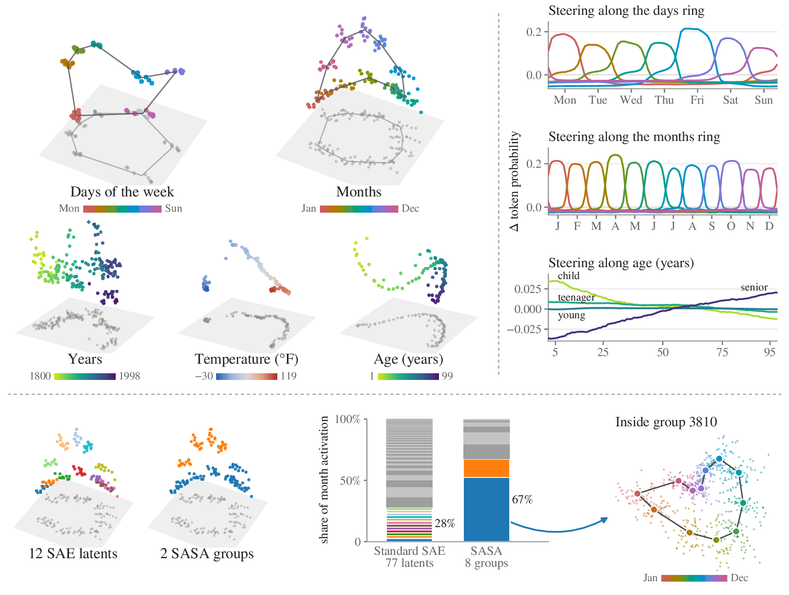

# Subspace-Aware Sparse Autoencoders (SASA)

Code for **Subspace-Aware Sparse Autoencoders for Effective Mechanistic Interpretability**.

Seyed Arshan Dalili and Mehrdad Mahdavi, NeurIPS 2026

Standard sparse autoencoders (SAEs) reconstruct language-model activations as sparse combinations of directions.
When a concept has multidimensional structure, this can split its representation across several SAE features.
SASA learns a low-dimensional subspace for each feature and activates its directions together, allowing a single
feature to capture the structure of concepts such as days of the week or months of the year.

This repository includes the [SAELens](https://github.com/jbloomAus/SAELens) implementation, pretrained models for
GPT-2 and Mistral-7B, and scripts to reproduce the paper's experiments.

<p align="center"></p>

[Setup](#setup) · [Pretrained models](#pretrained-models) · [Experiments](#experiments) · [Citation](#citation)

## Setup

```bash
git clone https://github.com/arshandalili/sasa && cd sasa
uv venv .venv --python 3.10
source .venv/bin/activate
uv pip install -r requirements.txt
```

Run all commands from the repository root with the environment active. The requirements pin the versions used in
the paper, including SAELens 6.25 and SAEBench. To use Mistral-7B, follow the access instructions on
[its model page](https://huggingface.co/mistralai/Mistral-7B-v0.1) and sign in with `hf auth login` or set `HF_TOKEN`.

## Pretrained models

| Language model | Activations | Hugging Face release |
| --- | --- | --- |
| GPT-2 small | Before block 7 (`blocks.7.hook_resid_pre`) | [SASA and the TopK, BatchTopK and Matryoshka baselines](https://huggingface.co/arshandalili/sasa-gpt2-layer7) |
| Mistral-7B-v0.1 | Before block 8 (`blocks.8.hook_resid_pre`) | [SASA](https://huggingface.co/arshandalili/sasa-mistral-7b-layer8) |

Import `sasa` to register the model with SAELens, then load a checkpoint. For example, given GPT-2 activations `h`
with shape `[tokens, 768]` from the location above:

```python
import sasa  # registers SASA with SAELens
from sae_lens import SAE

sae = SAE.from_pretrained("arshandalili/sasa-gpt2-layer7", "sasa_r6_l0120_w24576")
codes = sae.encode(h.to(device=sae.device, dtype=sae.dtype))
groups = codes.reshape(-1, sae.n_groups, sae.group_rank)  # [tokens, 4096, 6]
reconstruction = sae.decode(codes)
```

This checkpoint has 4,096 groups of six directions and activates 20 groups per token. Each group's activation
strength is `groups.norm(dim=-1)`.

For Mistral, use the checkpoint `sasa_r8_k10` from the Mistral release. Its `encode()` method selects active groups
across the batch. The paper's evaluations use a calibrated threshold instead; see the
[model card](https://huggingface.co/arshandalili/sasa-mistral-7b-layer8) for details.

## Experiments

Download the checkpoints, then run the experiments below. The [synthetic experiments](#synthetic-experiments)
generate their own data and can run directly after [setup](#setup).

### Download the checkpoints

The full GPT-2 release is 7.9 GB; the Mistral release is 1.1 GB.

```bash
hf download arshandalili/sasa-gpt2-layer7 --local-dir checkpoints/gpt2_l7
hf download arshandalili/sasa-mistral-7b-layer8 --local-dir checkpoints/mistral_l8
```

To download a single model, add `--include "<checkpoint>/*"`, for example `--include "sasa_r6_l0120_w24576/*"`.

Model names have the form `<config>/<checkpoint>`, such as `gpt2_l7/sasa_r6_l0120_w24576`.
Run `python -m configs gpt2_l7` to list the available GPT-2 checkpoints. Training settings are in [configs/](configs/).

<details>
<summary>Optional: train the models from scratch</summary>

GPT-2 training first needs an activation cache: 300M OpenWebText tokens, about 0.9 TB of disk space.

```bash
python cache.py gpt2_l7
python train.py gpt2_l7/sasa_r6_l0120_w24576
```

Mistral computes activations during training. Calibrate each new model's activation threshold afterward; the
included threshold is specific to the released weights.

```bash
python train.py mistral_l8/sasa_r8_k10
python -m eval.gate mistral_l8/sasa_r8_k10
```

</details>

### GPT-2

The core, absorption and member-prediction examples use `sasa_r6_l0120_w24576`. Replace it or pass additional
checkpoint names to evaluate other models.

**Reconstruction and model behavior.** Run SAEBench to measure reconstruction quality and how well the SAE
preserves GPT-2's predictions. Results include cross-entropy (CE) score, KL score and explained variance.

```bash
python -m eval.core gpt2_l7/sasa_r6_l0120_w24576
```

To compare with the pretrained GPT-2 SAE of Bloom (2024), which SAELens downloads, add `gpt2_l7/jb_relu_w24576`.

**Feature absorption.** Measure how much of a concept's signal is carried by features other than its main detectors.
Evaluate individual decoder directions for first letters and whole SASA groups for ten concept families, including
months and colors.

Prepare the shared data. Preparation and scoring both use three seeds (0, 1 and 2) by default.

```bash
python -m eval.absorption prep letters gpt2_l7
python -m eval.member_prediction collect gpt2_l7
python -m eval.absorption prep families gpt2_l7
```

Then evaluate the checkpoint on both benchmarks:

```bash
python -m eval.absorption score letters gpt2_l7/sasa_r6_l0120_w24576
python -m eval.absorption score families gpt2_l7/sasa_r6_l0120_w24576
```

**Member prediction.** Test whether features distinguish family members, such as January from February. This uses
the data collected above, budgets of 6 or 24 decoder directions, and three train/test splits:

```bash
python -m eval.member_prediction score gpt2_l7/sasa_r6_l0120_w24576
```

Absorption and member prediction reuse completed results, so you can rerun these commands after an interruption.

**Automated interpretability.** Generate and score feature descriptions with SAEBench's AutoInterp
evaluation, using gpt-4o-mini through OpenAI's Batch API. Set `OPENAI_API_KEY`, then run the stages in order:

```bash
python -m eval.autointerp prepare
python -m eval.autointerp explain
python -m eval.autointerp score
python -m eval.autointerp results
```

Only `prepare` needs a GPU; `explain` and `score` wait for batch jobs and resume unfinished work when rerun.

**Reconstruction and absorption plot.** This compares SASA, TopK, BatchTopK and Matryoshka. First run the core and
both absorption evaluations for their 24,576-column checkpoints at sparsity settings 60, 120 and 240 (using rank 6
for SASA), then generate the plot:

```bash
python -m figures.grid
```

**Subspace overlap.** Measure shared directions among the 500 most active SASA groups:

```bash
python -m eval.overlap gpt2_l7/sasa_r6_l060_w12288
```

### Mistral-7B

For the absorption comparison and feature visualizations, also download Engels et al.'s pretrained SAE,
`Mistral-7B-v0.1_blocks.8.hook_resid_pre_65536_final.pt`, through
[their repository](https://github.com/JoshEngels/MultiDimensionalFeatures), then convert it:

```bash
python -m eval.dictionaries Mistral-7B-v0.1_blocks.8.hook_resid_pre_65536_final.pt
```

**Feature absorption.** Compare SASA with the Engels et al. baseline on the first-letter benchmark, using the
default three seeds:

```bash
python -m eval.absorption prep letters mistral_l8
python -m eval.absorption score letters mistral_l8/sasa_r8_k10 mistral_l8/engels_relu_w65536
```

**Causal interventions.** Measure how removing or changing a SASA feature affects the language
model's predictions:

```bash
python -m eval.causal mistral_l8/sasa_r8_k10
```

**Feature visualizations.** Collect the activations, then plot the learned feature structure:

```bash
python -m eval.real_manifolds && python -m figures.real_manifolds
```

### Synthetic experiments

These experiments generate activations with known feature structure and require no language model or checkpoint.

```bash
python -m synthetic.feature_dimension
python -m synthetic.rank_adaptivity
python -m synthetic.manifolds
python -m figures.synthetic_manifolds
```

<details>
<summary>File locations and reporting results</summary>

By default, checkpoints, cached activations, results and evaluation data live in `checkpoints/`, `activations/`,
`results/` and `data/`. Override these locations with `SASA_CHECKPOINTS`, `SASA_ACTIVATIONS`, `SASA_RESULTS` and
`SASA_DATA`, respectively. If you change `SASA_CHECKPOINTS`, use the same location in the download commands.

Each evaluation writes its results under `results/` (or `SASA_RESULTS`):

| Evaluation | Result location |
| --- | --- |
| Reconstruction and model behavior | `core/gpt2_l7/` |
| Feature absorption | `absorption/<letters or families>/<config>/<checkpoint>/seed<k>.json` |
| Member prediction | `member_prediction/gpt2_l7.json` |
| Automated interpretability | `autointerp/results.json` |
| Subspace overlap | `overlap/gpt2_l7/sasa_r6_l060_w12288/overlap.json` |
| Causal interventions | `causal/mistral_l8/sasa_r8_k10/causal.json` |
| Synthetic experiments | `synthetic/` |

For evaluations with multiple seeds or train/test splits, report the mean and, where shown in the paper, the sample
standard deviation. Convert fractional scores to percentages when matching percentage-based table entries.

</details>

## Repository structure

| Path | Contents |
| --- | --- |
| [sasa/](sasa/) | SASA model implementation |
| [configs/](configs/) | Training settings for GPT-2 and Mistral-7B |
| [cache.py](cache.py), [train.py](train.py) | Activation caching and model training |
| [eval/](eval/) | Evaluations on language models |
| [synthetic/](synthetic/) | Experiments with generated features of known dimension |
| [figures/](figures/) | Scripts to plot the results |
| [data/](data/) | Evaluation data and the released Mistral model's activation threshold |

## Citation

```bibtex
@inproceedings{dalili2026sasa,
  title     = {Subspace-Aware Sparse Autoencoders for Effective Mechanistic Interpretability},
  author    = {Dalili, Seyed Arshan and Mahdavi, Mehrdad},
  booktitle = {Advances in Neural Information Processing Systems},
  year      = {2026}
}
```
